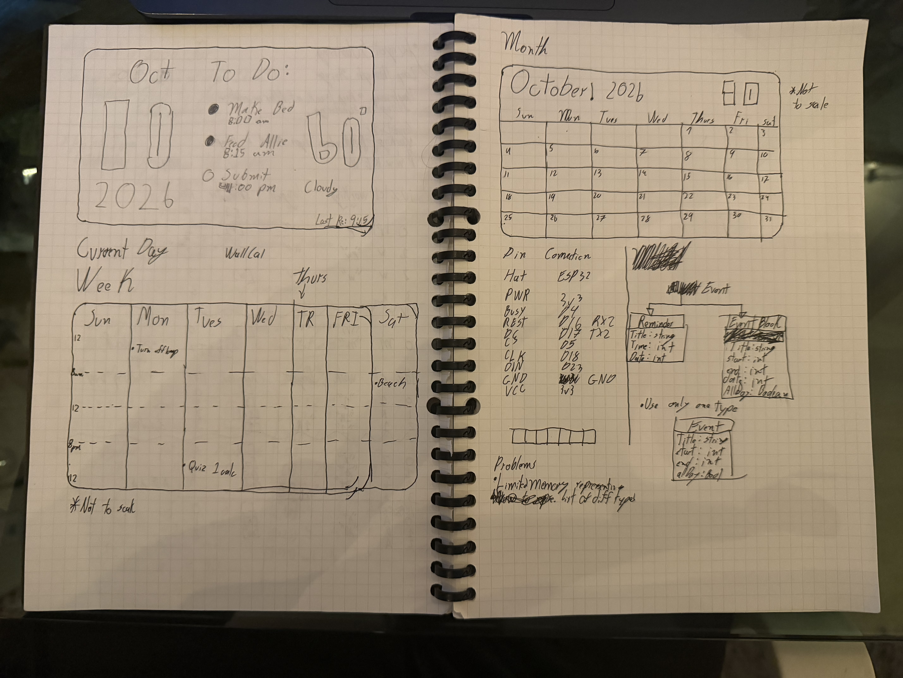
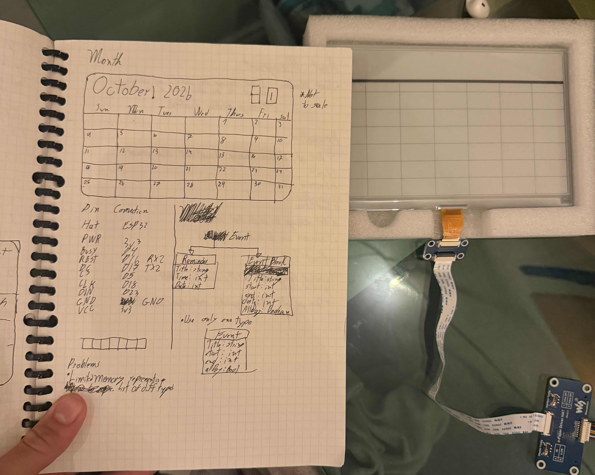

# WallCal

## Goal
* Build a wall calendar using an ESP32 and an E-ink display for low power consumption. 
* Calendar can retrieve events from a shared Apple Calendar.
* Multiple views that can be switched through a rotary knob 

## Progress
- [x] Display test working with GxEPD2
- [x] Migrated project to PlatformIO
- [x] Event data model
- [ ] Month view (in progress)
- [ ] Fetch events from shared Apple Calendar
- [ ] Multiple views switchable with a rotary knob
- [ ] Design and 3D Print Enclosure
### Hardware
* ESP32 Chip
* Waveshare 7.5" E-Ink Display
* 3D Printed Case for Components and Mounting. 

### Design 

  
  

